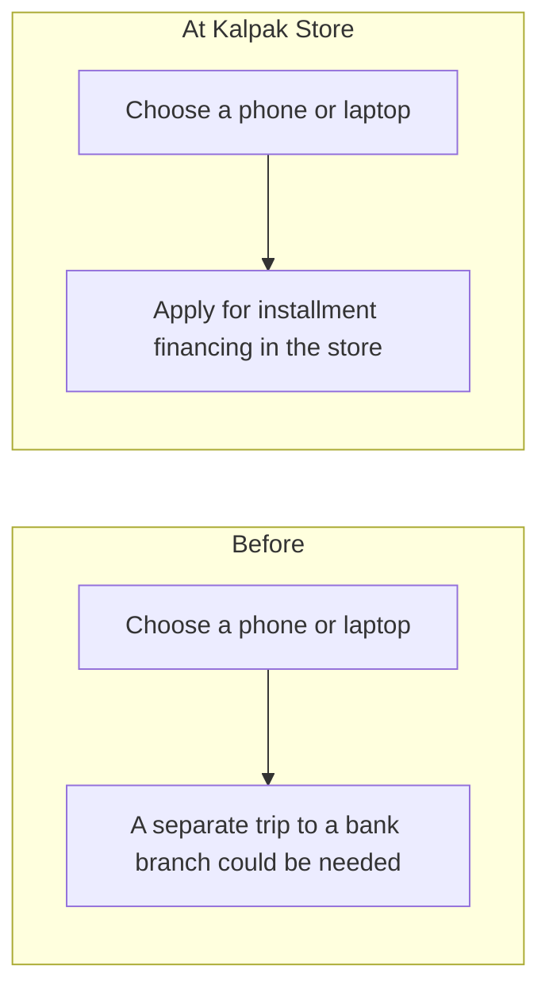

# Kalpak Store · In-store Installment Financing

**Co-founder**  
Osh, Kyrgyzstan · Launched in 2023

I proposed opening an electronics retail business in Osh. My co-founder and I contributed resources equally and launched two stores selling phones, laptops, and other consumer electronics.

## The customer problem

Buying a phone or laptop on installments could require a separate trip to a bank. We wanted customers to be able to apply for financing directly at the store.

## What we did

**My role**

- Proposed the idea for the business.
- Drew on my banking and microfinance experience to help establish installment financing arrangements with MBank, Kyrgyzkommertsbank, M Bulak, and Bakai Bank.

**Together with my co-founder**

- Planned the launch, found retail locations, hired staff, and sourced inventory.
- Introduced an in-store process that let customers apply for financing while shopping.

My co-founder then ran store operations while I continued working at Elet-Capital.

## Result

Customers could apply for installment financing at either location without a separate trip to a bank branch. When I moved to the United States, I exited the business and received payment for my ownership stake. My co-founder continued running the stores.

This project taught me to map a customer process end to end, coordinate external partners, and make a new workflow practical for frontline staff.

## Store location and photos

**Kalpak Store** · 40 Absamat Masaliev Avenue, Osh, Kyrgyzstan

This is one of the two electronics stores we opened in Osh. The public map listing shows the shop’s location and includes photos.

[View the store listing](https://yandex.com/maps/org/kalpakstore/52243165488/) · [View the photo gallery](https://yandex.com/maps/org/kalpak/52243165488/gallery/)
